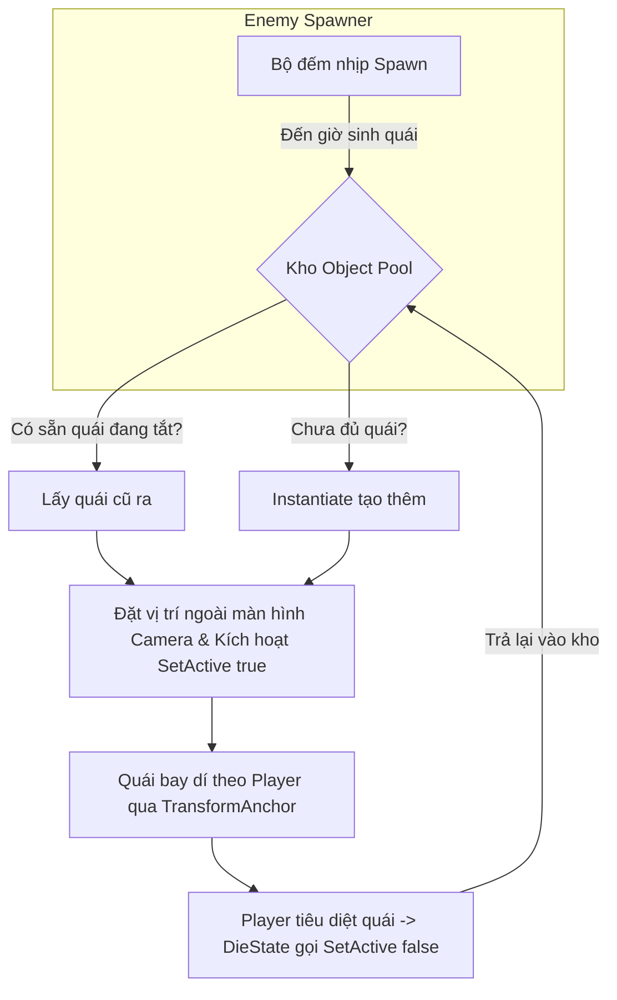

# Bước 4: Hệ thống Sinh Quái Tự Động & Tái Sử Dụng (Enemy Spawner & Object Pooling)

Tài liệu này ghi lại toàn bộ kế hoạch, tư duy kiến trúc và hướng dẫn từng bước để bạn tự thực hiện **Bước 4**: Kết nối thành quả của cả 3 bước trước để biến game từ trạng thái "chỉ có 1 con quái đặt tay trong Scene" thành một **vòng lặp sinh tồn thực thụ (Survivor Gameplay Loop)** với hiệu năng tối đa 60 FPS.

---

## 1. Bản chất vấn đề & Tư duy kiến trúc

### Vấn đề hiện tại:
1. **Quái vật chết rồi "mất tích"**: Trong [`DieState.cs`](file:///d:/UnityLearn/MyGame/Witch/Assets/Scripts/States/Shared/DieState.cs#L24), khi quái chết nó chỉ gọi `_health.gameObject.SetActive(false);` rồi nằm im vĩnh viễn trong Scene.
2. **Chưa có Spawner tự động**: Bạn phải kéo thả từng con quái bằng tay vào Scene.
3. **`DamageDealer` chưa ăn khớp với `EnemyData`**: Biến `damage` và `knockBackForce` trong [`DamageDealer.cs`](file:///d:/UnityLearn/MyGame/Witch/Assets/Scripts/Combat/DamageDealer.cs) vẫn đang hardcode riêng rẽ, chưa nhận giá trị từ `EnemyData` ở Bước 3.
4. **Hiểm họa giật lag (GC Allocation)**: Nếu cứ `Instantiate` (sinh quái) và `Destroy` (hủy quái) liên tục hàng trăm con trong game Roguelike, trình dọn rác (Garbage Collector) của Unity sẽ kích hoạt liên tục gây khựng hình (drop FPS).

---

### Giải pháp: Object Pooling & Data-Driven Spawner
Thay vì tạo mới và hủy liên tục, ta xây dựng một "kho chứa" (Object Pool):



---

## 2. Chi tiết các file cần sửa & tạo mới

---

### File 1: [`Assets/Scripts/Combat/Health.cs`](file:///d:/UnityLearn/MyGame/Witch/Assets/Scripts/Combat/Health.cs)
> **Mục tiêu:** Khi quái được tái sinh từ Pool, máu phải hồi đầy và cờ `isDead` phải được đặt lại về `false` (nếu không quái hồi sinh sẽ không thể nhận sát thương được nữa).

Trong hàm `SetMaxHealth`, thêm dòng reset `isDead = false;`:

```csharp
public virtual void SetMaxHealth(float maxHealth)
{
    _maxHealth = maxHealth;
    _currentHealth = maxHealth;
    isDead = false; // [MỚI] Cực kỳ quan trọng: Cho phép nhận sát thương trở lại khi tái sinh từ Pool!
    OnHealthChanged?.Invoke(_currentHealth, _maxHealth);
}
```

---

### File 2: [`Assets/Scripts/Combat/DamageDealer.cs`](file:///d:/UnityLearn/MyGame/Witch/Assets/Scripts/Combat/DamageDealer.cs)
> **Mục tiêu:** 
> 1. Đồng bộ sát thương và lực đẩy lùi từ `EnemyData`.
> 2. Tối ưu hiệu năng: Dùng `TryGetComponent` thay vì gọi `GetComponent` 2 lần.

Thay thế toàn bộ file `DamageDealer.cs` thành:

```csharp
using UnityEngine;

public class DamageDealer : MonoBehaviour
{
    [SerializeField] private float damage = 10f;
    [SerializeField] private float knockBackForce = 5f;

    // [MỚI] Cho phép EnemyCore truyền thông số từ EnemyData vào hitbox
    public void SetCombatStats(float newDamage, float newKnockBackForce)
    {
        damage = newDamage;
        knockBackForce = newKnockBackForce;
    }

    private void OnTriggerEnter2D(Collider2D collision)
    {
        // [TỐI ƯU] TryGetComponent nhanh hơn và không sinh rác bộ nhớ so với GetComponent != null
        if (collision.TryGetComponent<IDamageable>(out var damageable))
        {
            Vector2 knockBackDir = ((Vector2)collision.transform.position - (Vector2)transform.position).normalized;
            damageable.TakeDamage(damage, knockBackDir, knockBackForce);
        }
    }
}
```

---

### File 3: [`Assets/Scripts/Core/EnemyCore.cs`](file:///d:/UnityLearn/MyGame/Witch/Assets/Scripts/Core/EnemyCore.cs)
> **Mục tiêu:** 
> 1. Đồng bộ thông số từ `enemyData` vào `DamageDealer` của hitbox.
> 2. Thêm hàm `ResetEnemy(Vector3 spawnPosition)` để hồi sinh quái sạch sẽ khi lấy ra từ Pool.

Thêm 2 đoạn code nhỏ vào `EnemyCore.cs`:

1. **Đồng bộ DamageDealer trong hàm `Start()`:**
   ```csharp
   protected virtual void Start()
   {
       // ... (các đoạn code targetAnchor cũ của bạn)

       // [MỚI] Cập nhật sát thương cho HitBox từ EnemyData
       DamageDealer damageDealer = GetComponentInChildren<DamageDealer>();
       if (damageDealer != null && enemyData != null)
       {
           damageDealer.SetCombatStats(enemyData.damage, enemyData.knockBackForce);
       }
   }
   ```

2. **Thêm hàm tái sinh `ResetEnemy`:**
   ```csharp
   // [MỚI] Gọi hàm này mỗi khi lấy quái từ Pool ra để quái trở lại trạng thái ban đầu
   public virtual void ResetEnemy(Vector3 spawnPosition)
   {
       transform.position = spawnPosition;
       if (enemyData != null && health != null)
       {
           health.SetMaxHealth(enemyData.maxHealth);
       }
       if (_machine != null && chaseState != null)
       {
           _machine.Initialize(chaseState);
       }
       gameObject.SetActive(true);
   }
   ```

---

### File 4: Tạo mới Script `EnemySpawner.cs`
Tạo file mới tại: `Assets/Scripts/Entity/EnemySpawner.cs` (hoặc trong thư mục `Core` tùy bạn):

```csharp
using System.Collections.Generic;
using UnityEngine;

public class EnemySpawner : MonoBehaviour
{
    [Header("Player Reference")]
    [Tooltip("Đọc vị trí Player qua ScriptableObject Anchor từ Bước 2")]
    [SerializeField] private TransformAnchor _playerAnchor;

    [Header("Spawn Settings")]
    [Tooltip("Prefab của quái vật")]
    [SerializeField] private GameObject _enemyPrefab;

    [Tooltip("Thời gian giữa các lần sinh quái (giây)")]
    [SerializeField] private float _spawnInterval = 2.5f;

    [Tooltip("Khoảng cách sinh quái so với Player (nên để ngoài màn hình Camera)")]
    [SerializeField] private float _spawnRadius = 12f;

    [Header("Pool Limit")]
    [Tooltip("Số lượng quái tối đa cùng xuất hiện")]
    [SerializeField] private int _maxEnemiesAlive = 15;

    // Kho chứa Object Pool
    private List<EnemyCore> _enemyPool = new List<EnemyCore>();
    private float _nextSpawnTime;

    private void Update()
    {
        // Nếu chưa có Player hoặc chưa đến thời gian spawn thì bỏ qua
        if (_playerAnchor == null || !_playerAnchor.HasValue) return;

        if (Time.time >= _nextSpawnTime)
        {
            _nextSpawnTime = Time.time + _spawnInterval;
            TrySpawnEnemy();
        }
    }

    private void TrySpawnEnemy()
    {
        // Đếm số quái đang sống trên màn hình
        int activeCount = 0;
        foreach (var enemy in _enemyPool)
        {
            if (enemy.gameObject.activeSelf) activeCount++;
        }

        // Nếu đã đủ số lượng quái tối đa thì tạm dừng sinh thêm
        if (activeCount >= _maxEnemiesAlive) return;

        // Tính toán vị trí ngẫu nhiên trên một vòng tròn xung quanh Player
        Vector2 randomCircle = Random.insideUnitCircle.normalized * _spawnRadius;
        Vector3 spawnPos = _playerAnchor.Value.position + new Vector3(randomCircle.x, randomCircle.y, 0f);

        // Lấy quái từ Pool hoặc tạo mới nếu kho hết
        EnemyCore enemyToSpawn = GetEnemyFromPool();
        enemyToSpawn.ResetEnemy(spawnPos);
    }

    private EnemyCore GetEnemyFromPool()
    {
        // 1. Tìm xem trong kho có con quái nào đang bị tắt (đã chết) không
        foreach (var enemy in _enemyPool)
        {
            if (!enemy.gameObject.activeSelf)
            {
                return enemy; // Tái sử dụng quái cũ!
            }
        }

        // 2. Nếu trong kho không còn con nào rảnh, Instantiate con mới và thêm vào kho
        GameObject newEnemyObj = Instantiate(_enemyPrefab, transform);
        EnemyCore newEnemy = newEnemyObj.GetComponent<EnemyCore>();
        _enemyPool.Add(newEnemy);
        return newEnemy;
    }
}
```

---

## 3. Các bước kiểm tra trong Unity Editor

1. **Lưu Prefab của DemonBat:**
   - Kéo GameObject `DemonBat` từ cửa sổ **Hierarchy** thả vào thư mục `Assets/Prefab` để tạo thành Prefab.
   - Xóa GameObject `DemonBat` cũ trong Hierarchy đi (vì bây giờ Spawner sẽ tự sinh ra nó).
2. **Tạo Spawner trong Scene:**
   - Trong Hierarchy, nhấp chuột phải $\rightarrow$ **Create Empty**, đặt tên là `EnemySpawner`.
   - Gắn component `EnemySpawner` vừa viết vào GameObject này.
   - Kéo file `PlayerTransformAnchor` vào ô **Player Anchor**.
   - Kéo Prefab `DemonBat` từ Project vào ô **Enemy Prefab**.
   - Chỉnh `Spawn Interval` = `2` (mỗi 2 giây sinh 1 con), `Spawn Radius` = `12`.
3. **Chạy thử Game (Play Mode):**
   - Đứng yên hoặc di chuyển nhân vật: Cứ mỗi 2 giây, một con quái dơi sẽ xuất hiện từ ngoài rìa màn hình và bay vào dí theo Player.
   - Khi quái chết, quan sát cửa sổ Hierarchy: **Không hề có GameObject mới nào bị sinh ra thêm**, Spawner sẽ tự lấy lại đúng những con dơi đã chết để hồi sinh ở vị trí mới!

---

## 4. Những điểm sáng kiến trúc trong Bước này

* **Zero GC Allocation**: Không gọi `Destroy(gameObject)`, CPU không bị giật lag dù quái xuất hiện và chết hàng trăm lần.
* **Tận dụng 100% thành quả các bước trước**:
  * Đọc vị trí sinh quái bằng `_playerAnchor` (từ Bước 2).
  * Quái tự nạp máu và chỉ số bằng `EnemyData` (từ Bước 3).
  * Quái tự cập nhật sát thương cho `DamageDealer` chuẩn xác.
